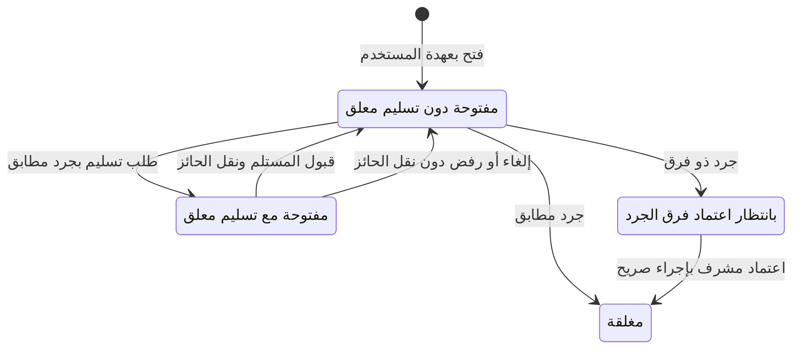

# ADR 0019 — ورديات الصندوق والعهدة R10-M02

التاريخ2026-11-11. يعتمد ADR0018 وقرار Q05. وردية واحدة غير مغلقة لكل صندوق، وحائز محدد؛ لا وردية تلقائية لكل مستخدم، ولا نقل ضمني للعهدة أو حذف للتاريخ.

CashShift داخل مخطط الشركة، بهوية صندوق/فرع/فاتح/وقت/عملة/عهدة افتتاحية ولقطة إعداد ثابتة. الحالة open أو review (جرد ذو فرق ينتظر اعتمادًا) أو closed. يحتفظ الحائز الحالي وطلب تسليم واحد بمستلم ومبلغ، وإصدار متزايد. لا يفتح صندوق معطل أو فرع/حساب/أجداد غير صالحين، ولا يعطل صندوق ذو وردية open/review أو تسليم معلق. قيد جزئي يمنع ورديتين غير مغلقتين؛ حارس SQL يمنع تعطيل الصندوق أو إعادة الوردية المغلقة وتغيير هوية أو مبالغ الجرد المثبتة.

Pending تمثيل لعلم التسليم داخل حالة open، وليس حالة قاعدة إضافية أو وردية جديدة. قبول التسليم يحفظ الوردية نفسها ويغير الحائز بإصدار وحدث جديدين.

القراءة بـpayment.read للفرع؛ الكتابة بـpayment.read وpayment.record مع وصول فرع حي. الفتح للنفس فقط. طلب التسليم من الحائز إلى مستخدم مخول نشط، وقبوله من المستلم نفسه بعد إعادة التفويض وفحص الإعداد والجرد. يرفض طلب تسليم إلى النفس أو رقم شركة/فرع آخر، ويشترط تطابق المعدود مع المتوقع؛ الفارق يعالج بالإغلاق والمراجعة لا بتحميله لمستلم جديد. يمكن للحائز إلغاء الطلب وللمستلم رفضه؛ لا يتغير الحائز قبل القبول. لا تحصيل أو إغلاق أثناء التسليم المعلق؛ M06 يلزم إعادة اختبار منع الدفع حينها.

المتوقع في M02 هو العهدة الافتتاحية فقط؛ لا دفعات بيع أو حركات نقدية بعد. مبالغ SAR Decimal حتى18 خانة بمنزلتين، دون float أو تقريب خفي، والفرق signed=counted−expected بدقة محلية40. الإغلاق المتطابق يغلق مباشرة؛ الفارق يحفظ الجرد وينقل إلى review. قرار المنتج في هذا الجزء: اعتماد الفارق إجراء منفصل بسبب إلزامي يحتاج payment.reverse مع صلاحيات القراءة/التسجيل للفرع؛ لا قيد تلقائي أو تسوية دفتر من هذا الاعتماد. لا فصل إلزامي بين الحائز والمشرف في هذه النسخة، لكن حتى صاحب الصلاحيتين ينفذ طلب الجرد ثم اعتمادًا صريحًا مستقلًا. تبقى إشارة الفارق ومبلغه وحائز العهدة محفوظة.

عند سحب صلاحية الحائز أو تعطيل حسابه، يستطيع مشرف مخول بـpayment.reverse إلغاء تسليم معلق وتقديم جرد إغلاق بدلًا منه، مع سجل الفاعل والحائز الأصلي؛ لا يعيد تفعيل حساب أو يتقمصه ولا ينقل العهدة بلا قبول. المشرف لا يعتمد فارق فرع غير مخول. تغيير قوالب الأدوار أو الاعتماد على superuser محظور؛ القوالب الحالية تكفي.

كل انتقال خدمة صريحة atomic تحت AccessLock، بإصدار متوقع ومفتاح UUID وبصمة محتوى/شركة/فاعل، وShiftEvent ثابت قبل/بعد وسبب وتدقيق في المعاملة نفسها. يعاد التفويض قبل replay؛ replay المطابق يعيد الحدث القديم ولا يعيد الانتقال بعد تغير الحائز. لا شبكة داخل القفل ولا أثر مالي في save(). تصحيح عهدة افتتاحية خاطئة بإغلاق موثق ثم وردية جديدة، لا تعديل الرقم القديم أو حذف الوردية.

runtime لا يحذف الوردية ولا يعدل الهوية والعهدة الافتتاحية، ولا يعدل أو يحذف الأحداث. مشغلات tenant-local SECURITY INVOKER ببحث pg_catalog وأسماء جداول مؤهلة من مخطط الترحيل، مع تحقق حدث الإصدار عند commit، تمنع رأسًا بلا حدث وتغييرات الحالات النهائية. قواعد التفويض والحساب والتسليم في الخدمات وليست ادعاء حماية من DBA.

القوائم والخيارات والعد والبحث والصفحات وlookup مقيدة بالفروع قبل الحد؛ شاشة تشغيل للكاشير منفصلة عن تعريف الصندوق الإداري، ولا تكشف حساب الربط أو JSON اللقطة. اختيارات المستلمين محدودة وببحث اسم دخول صريح بدل تحميل جميع الموظفين. HTML عربي يعمل دون JavaScript؛ POST وCSRF لكل انتقال. إثبات PostgreSQL للقيود والمنح والتزامن والذرية والعزل ومراجعة الفروق واستعادة العهدة، ومتصفح لسطح المكتب والهاتف. ربط الدفعات والتوقع المتغير والدفتر يثبت في M06؛ لا فوترة/ضريبة/امتثال/اتصال هيئة أو تأمين من هذه المرحلة.

أغلقت M02 وفق T054/T055 في2026-11-11؛ CI42962912458 للـcommit ae551f951bfad195ca7c6a609e71883c0987c996 اجتاز323 حالة كاملة. حدود التوقع الافتتاحي والمطابقة اللاحقة مع التحصيل أعلاه مستمرة؛ R10 مستمرة والتالي M03.
