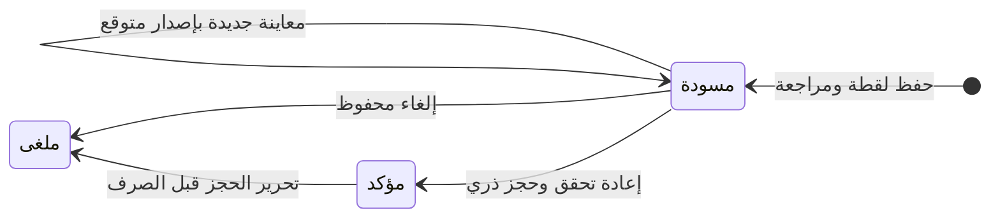

# ADR0021 — طلب البيع والحجز R10-M04

2026-11-11. يعتمد ADR0007/0010/0013/0019/0020. طلب داخل الشركة لعميل واحد وفرع ووردية ثابتة، بحالات draft/confirmed/cancelled وإصدارات محتوى وأحداث ثابتة. لا فاتورة أو تحصيل أو صرف أو ترحيل مالي في M04.

لا إعادة فتح للملغى أو تعديل محتوى المؤكد. M05 يضيف بوابة تمنع هذا الإلغاء بعد إصدار فاتورة، ويعيد مراجعة سياق الفوترة وإعداداته دون تعديل صامت للطلب المؤكد؛ M07 يثبت التسليم والمرتجع المرتبطين بالأصل.

مصدر المحتوى معاينة M03 محفوظة لليوم وبعميل صريح. تحفظ لقطة بيانات العميل ورقم إصداره، ولقطة السعر والتصنيف والصنف والوحدة، واختيار إصدار وصفة من الفرع نفسه والعميل نفسه. الوصفة اختيارية إلا عدسات التصنيع، التي تحتاج قياسات فعلية؛ لا اشتراط صورة. تحفظ هوية صورة الإصدار وبصمتها إن وجدت دون نسخ bytes أو عنوان عام. قراءة أي طلب ذي تاريخ وصفة تحتاج prescription.read؛ لا كشف لوصفة قديمة عبر حذفها من الإصدار الحالي. القراءة كذلك invoice.read وcatalog.read وcustomer.read ورابط العميل الحالي، قبل العد والصفحات وlookup. ربط الفحص لا يمنح صلاحيات طبية للكاشير؛ تستخدم قوالب الأدوار القائمة.

الإنشاء/تعديل المسودة invoice.create، والتأكيد/الإلغاء invoice.confirm، مع إعادة التفويض داخل AccessLock حتى replay. حفظ وتأكيد يحتاجان عميلًا نشطًا ووردية مفتوحة بعهدة الفاعل دون تسليم معلق، وصندوقًا وحسابًا صالحين في الفرع. لا تبديل صامت للعميل/الفرع/الوردية. التأكيد يعيد حساب المعاينة من المدخلات الحالية؛ أي اختلاف في لقطة السعر أو التصنيف أو ملف البائع أو العميل، أو تصحيح الفحص، يرفض حتى مراجعة مسودة جديدة. لا قبول زيادة السعر تلقائيًا، ولا حجز عند حفظ المسودة.

تأكيد جميع البنود atomic مع التدقيق: المخزني يحجز SKU/كمية/هوية تتبع صريحة، والخدمة وعدسة التصنيع لا تنشئ رصيدًا وهميًا. اختيار الدفعة أو التسلسل من الفرع وSKU، وصلاحيتها وفحص المتاح وفق R08؛ تنفيذ التصنيع/التسليم غير المخزني يثبت لاحقًا في M07. لا انتهاء حجز تلقائي. الإلغاء يحفظ الأصل ويحرر الحجوزات كاملة، ويرفض أي صرف/تغيير سابق بدل اختراع مرتجع مالي. إلغاء الطلب المؤكد لا يحتاج وردية مفتوحة أو صنفًا نشطًا؛ صلاحية القراءة وروابط العميل والفحص تبقى لازمة، واستعادة رابط مفقود تتم بإجراء المشاركة المصرح القائم.

قوالب الأدوار ثابتة. حجز المبيعات أثر تابع لتأكيد الطلب بصلاحية invoice.confirm، وليس منحة stock.reserve أو stock.issue للكاشير. نواة المخزون الخاصة تستعمل بعد تفويض الطلب، ولا يوجد skip_permission في واجهة عامة. OrderHold ثابت يربط البند والحجز، وتمنع خدمات المخزون العامة issue/release/cancel/reverse لحجز مرتبط بالمبيعات؛ M07 يستعمل مسار تسليم مصرحًا. لا تعديل حجوزات المبيعات من شاشة مخزون يدوي. سحب صلاحية التأكيد يمنع replay والعمل الجديد.

كل تغيير إصدار متوقع ومفتاح UUID وبصمة وسبب وتدقيق. الطلب له أحداث ثابتة؛ runtime يعدل مؤشرات الحالة/الإصدار فقط، ولا يمحو الطلب أو نسخه أو ربط الحجز. قيود PostgreSQL والتزامن وrollback وإعادة التسعير والعزل وHTTP/CSRF ومتصفح RTL للهاتف دون JavaScript معايير إغلاق M04. بوابات ZATCA وSDK وتصنيف المنشأة الفعلي لم تغلق، ولا يعد هذا إصدار فاتورة.
